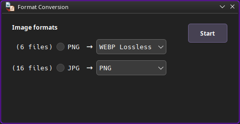

# mkConversions

A small Qt6 dialog for batch-converting image, audio and video files between formats, with a Dolphin
context menu entry. It is a Linux port of the former AutoHotkey v1.1 script `Conversions.ahk`.

> **Note:** after a successful conversion the **source file is deleted**. See [Usage](#usage) for the safeguards.



## Usage

```
mkConversions [-r|--recursive] <files and/or folders...>
```

- Folders are searched for files (with `-r` also subfolders).
- The dialog only shows the columns (image/audio/video) and source formats (file extensions) that occur in the given
  files. For each source format there is a row `( ) PNG -> [target format ▾]`; the list contains all
  formats of the category except the source format (lossless ones first). If a lossy target is selected,
  the row turns **red** and the start has to be confirmed.
- The target format last used for each source format is remembered and preselected next time
  (stored in `~/.local/state/mkProjects/mkConversions_state.conf`).
- **Start** → **Pause** → **Continue** … → **Close**. Pause takes effect as soon as the current file is finished.
- After a successful conversion the **source file is deleted**. If the target file already exists, the file is skipped.
- Close/Escape during the conversion aborts it: the running process is terminated, the unfinished target file is deleted,
  the source file is kept.
- Errors and notes are collected and shown in a report at the end.

## Conversions

**Images** – sources: BMP, PNG, JPG, JXL, WEBP. Targets (each excluding the source format):

| Target              | Command                                                                |
|---------------------|------------------------------------------------------------------------|
| PNG                 | `magick SRC [PNG24:]DST` (PNG24 only from BMP/JPG, otherwise alpha/16 bit are preserved) |
| BMP                 | `magick SRC DST`                                                       |
| JXL Lossless        | `magick SRC -quality 100 DST`; from JPG: `cjxl --lossless_jpeg=1 SRC DST` (reversible via `djxl`) |
| WEBP Lossless       | `magick SRC -define webp:lossless=true DST` (WebP supports max. 8 bit/channel) |
| JPG (Q92) *(lossy)* | `magick SRC -background white -alpha remove -alpha off -quality 92 DST` |
| JXL (Q96) *(lossy)* | `magick SRC -quality 96 DST`                                           |
| WEBP (Q90) *(lossy)*| `magick SRC -quality 90 DST`                                           |

**Audio** – sources: AAC, FLAC, MP3, WAV.

| Target                   | Command                                                           |
|--------------------------|-------------------------------------------------------------------|
| WAV                      | AAC: `faad -q -d`, FLAC: `flac -s -d`, MP3: `lame --decode`       |
| FLAC                     | WAV: `flac -s`; AAC/MP3: `ffmpeg -c:a flac -sample_fmt s16`       |
| M4A                      | AAC: `ffmpeg -c:a copy` (losslessly repackaged)                   |
| M4A (AAC 256k) *(lossy)* | `ffmpeg -c:a aac -b:a 256k -movflags +faststart`                  |
| AAC (256k) *(lossy)*     | `ffmpeg -c:a aac -b:a 256k`                                       |
| MP3 (V0) *(lossy)*       | WAV: `lame -V 0` (= `--preset extreme`); otherwise `ffmpeg -c:a libmp3lame -q:a 0` |

**Video** – source: MP4 → M4A: `ffmpeg -vn -c:a copy -movflags +faststart` (extract the audio track losslessly).

All ffmpeg calls run with `-n -vn` (never overwrite, audio only).
**Animated** JXL/WebP files are skipped (checked via `jxlinfo` or `magick identify`), because ImageMagick
would otherwise take over only the first frame or write several individual files, and the source is deleted afterwards.

Extensions are recognized case-insensitively; `.jpeg` counts as JPG.
A conversion is only considered successful if the tool exits with code 0 **and** a non-empty target file exists.

## Requirements

- Qt ≥ 6.5 (Core, Widgets, LinguistTools), CMake ≥ 3.19 and a C++ compiler
- At runtime, the external tools used for the conversions. Only the tools for the formats you actually convert
  are needed.

On Arch Linux:

```bash
sudo pacman -S --needed base-devel cmake qt6-base qt6-tools              # build
sudo pacman -S --needed imagemagick libjxl libwebp ffmpeg flac lame faad2  # runtime tools
```

## Building and installing

```bash
git clone https://github.com/KrokusPokus/mkConversions.git
cd mkConversions
cmake -B build -DCMAKE_BUILD_TYPE=Release -DCMAKE_INSTALL_PREFIX=/usr
cmake --build build --parallel
sudo cmake --install build                   # installs system-wide
sudo xargs rm < build/install_manifest.txt   # uninstalls again
```

For development, `./build.sh` builds into `build/bin/` without installing, and `./build_lupdate.sh` updates the
translation sources in `i18n/*.ts`.

## Dolphin context menu

`cmake --install` adds two entries to `<prefix>/share/kio/servicemenus/`: *Convert formats* (files and folders) and
*… (including subfolders)* (folders only).

## License

GPL-3.0-only, see [LICENSE](LICENSE).
